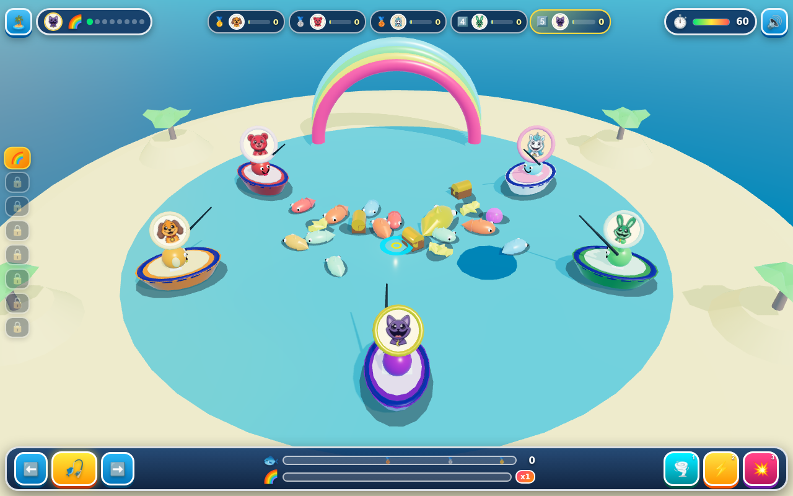

# 🎣 Critter Fishing Derby 3D: Rainbow Lagoon! 🌈🐋🏆

**Play Live**: https://kunruiw1991.github.io/critters-fishing3d/  
**GitHub Repository**: https://github.com/kunruiw1991/critters-fishing3d

## 🌟 Overview
**Critter Fishing Derby 3D: Rainbow Lagoon!** is a Three.js (`r161`) 3D WebGL lagoon boat fishing and treasure derby designed for young children with a **100% Zero-Text Visual Cockpit**. Five Smiling Critters sit in colorful 3D boats around an animated crystal lagoon teeming with 3D swimming rainbow fish, golden whales, starfish, treasure chests, and shocking jellyfish.

## 🎮 Core 3D Gameplay & Mechanics
- **8 Selectable Smiling Critters (`icons/*.jpg`)**: Choose from CatNap, DogDay, Bobby BearHug, CraftyCorn, Hoppy Hopscotch, KickinChicken, PickyPiggy, or Bubba Bubbaphant (`THREE.SRGBColorSpace` portrait medallions with un-tonemapped vibrant faces and custom 3D species ears/horns/snouts).
- **8 Distinct 3D Lagoon Stages**:
  1. 🌈 **Rainbow Coral Cove** (Coral Arch & Tropical Shoals)
  2. ☀️ **Sunny Lighthouse Bay** (Golden Lighthouse & Goldfish Schools)
  3. 🍭 **Candy Kelp Atoll** (Swirling Lollipop Pillars & Pink Starfish)
  4. ❄️ **Crystal Frost Fjord** (Glacier Spires & Silver Whales)
  5. 🌋 **Tiki Ember Lagoon** (Glowing Volcano Totems & Ruby Chests)
  6. 🌸 **Blossom Lily Pond** (Giant Lotus Pads & Koi Swirls)
  7. ⚓ **Emerald Pirate Wreck** (Sunken Galleon & Doubloon Chests)
  8. 👑 **Royal Crown Sanctuary** (Golden Crown Reef & Grand Champion Derby)
- **Aim, Parabolic 3D Cast & Thrashing Reel**:
  - Steer the glowing 3D target ring across the lagoon (`Arrow`/`WASD` or Mouse/Touch aim).
  - Press `Space` / Click / `🎣` to launch the 3D bobber & hook along a parabolic arc into the water, creating expanding 3D splash rings.
  - Hook swimming 3D fish, golden whales, and sunken treasure chests, then reel them back to your boat with flying 3D star-coins!
- **3 Tactile Power Pedals**:
  - `1` / `🌪️` **Whirlpool Magnet Lure**: Spawns a spinning 3D aqua vortex that pulls nearby fish and chests right onto your hook.
  - `2` / `⚡` **Golden Super Net**: Casts a glittering 3D golden net across the target zone to scoop up a multi-fish catch cluster.
  - `3` / `💥` **Depth Shockwave**: Emits an expanding 3D sonic wave that clears shocking jellyfish (`🪼`), bumps rival lines, and surfaces a bonus Treasure Chest (`🧰`).
- **Rainbow Fever (`🌈`)**: Fill the Rainbow Fever bar through consecutive catches and Power Pedal uses (`+12` Fever) to trigger 7 seconds of `2.0x` catch points, `1.35x` reel speed, rainbow boat wakes, and golden fish spawns!
- **Strict Top-3 Podium Qualification**:
  - `🥇 1st Place` = `⭐⭐⭐` (3 Stars) — Unlocks next lagoon!
  - `🥈 2nd Place` = `⭐⭐` (2 Stars) — Unlocks next lagoon!
  - `🥉 3rd Place` = `⭐` (1 Star) — Unlocks next lagoon!
  - `4th / 5th Place` = `😢 💔 0⭐` (**Sad Defeat**) — Retry-only screen with no stage unlock!

## 🕹️ Controls & Keyboard / Touch Reference

| Action | Keyboard | Mouse / Touch / Cockpit UI |
| :--- | :--- | :--- |
| **Aim Target Ring** | `Arrow Keys` or `W` `A` `S` `D` | Move pointer / drag on lagoon water, or hold `⬅️` / `➡️` cockpit buttons |
| **Cast Bobber / Reel Hook** | `Space` or `Enter` | Click / tap lagoon water or press center `🎣` / `🌀` Cast-Reel button |
| **Whirlpool Magnet Lure** | `1` or `Numpad 1` | Tap `🌪️` Pedal 1 button |
| **Golden Super Net** | `2` or `Numpad 2` | Tap `⚡` Pedal 2 button |
| **Depth Shockwave** | `3` or `Numpad 3` | Tap `💥` Pedal 3 button |
| **Podium Next / Retry** | `Space` or `Enter` | Tap `🏝️▶️` Next Lagoon (Top-3) or `🔄` Retry Lagoon |
| **Stage Select / Sound** | Click top-left `🏝️` / top-right `🔊` | Tap `🏝️` Menu button, left Stage Rail pills, or `🔊` Mute toggle |

## 🛠️ 3D Technical & Audio Architecture
- **Three.js `r161` Seamless Lagoon & Wave Displacement**: Real-time vertex wave displacement (`waveHeight(x, z, t)`) with smooth shore falloff, `PCFSoftShadowMap` directional sunlight, and adaptive FOV framing (`fitCamera()`) across desktop (`1280x800`), mobile portrait (`390x844`), and short-height landscape (`844x390`, `740x360`) viewports.
- **Zero-Churn Object Pooling**:
  - **256-Slot `THREE.InstancedMesh` Particle System**: Gravity-driven (`-18 u/s²`) 3D water droplets, golden catch bursts, and Rainbow Fever wakes with zero runtime geometry/material allocations.
  - **40-Slot `THREE.ExtrudeGeometry` 5-Point Star Coin Pool**: Parabolic 3D star-coins fly from catches to the live HUD / boat target and increment scores upon arrival.
  - **14-Slot 3D Splash Ring Pool & Constant-Thickness Shockwave Ring**: Polygon-offset water decals (`depthWrite: false`) prevent z-fighting with displaced lagoon waves.
- **Damped-Spring Boat Physics & Buoyancy**: All 5 boats integrate roll and pitch angular springs ($\theta'' = -k\theta - c\theta'$, $k=38, c=5.4$) with fish-weight line tension jerks, boat hull capsule repulsion, and smooth time-based `17/23/31 Hz` trauma camera shake.
- **Perceptual Color Contrast Guardrails**: Enforces CIELAB $\Delta E_{76} \ge 20$ contrast between stage water palettes and swimming fish species so targets pop clearly on every lagoon.
- **Procedural Web Audio Synthesizer (`SFX`)**: Zero external audio files required — synthesizes `cast()`, `splash()`, `bite()`, `tug()`, ascending `coinTick(step)`, `catchFish()`, `feverChime()`, `pedal(0..2)`, `shockHit()`, `zap()`, triumphant Victory Fanfare (`fanfare(true)`), and brassy sawtooth Defeat Trombone glissandos (`fanfare(false)`).

## 🔄 10-Round Creator + Critic Refinement Changelog
1. **Round 1 — Initial Three.js `r161` 3D Lagoon Architecture**: Built the 5-Critter boat ring, animated crystal lagoon water, 8 selectable Smiling Critter captains (`icons/*.jpg`), 8 lagoon stages, parabolic bobber casting, 3 Power Pedals, and Top-3 qualification flow.
2. **Round 2 — Seamless 3D World, Lighting & Asset Fidelity**: Eliminated horizon seams with a 175u sky dome and outer ocean plane, enabled `PCFSoftShadowMap` shadows and soft contact blob shadows, and fixed billboard orientation so all 5 Critter portrait medallions face the camera cleanly.
3. **Round 3 — Species-Specific 3D Critter Figures & Color Contrast**: Added custom 3D species geometry (CatNap cat ears/tail, DogDay floppy ears/snout, Hoppy bunny ears, CraftyCorn unicorn horn, Bubba elephant ears/trunk, Kickin comb/beak, Picky snout, Bobby round ears) and enforced CIELAB $\Delta E_{76} \ge 20$ fish-vs-water contrast across all 8 stages.
4. **Round 4 — Zero-Text Visual Cockpit & Tactile HUD**: Refined the 100% icon-driven HUD with live 5-Critter rank chips, bronze/silver/gold quota markers (`.reached`), Rainbow Fever cockpit glow (`.fever-active`), and `.is-ready` / `.is-active` / `.on-cooldown` / `.pressed` pedal states.
5. **Round 5 — 3D Physics, Fish Separation & Damped-Spring Boats**: Implemented fish-to-fish separation, boat hull capsule repulsion, damped-spring boat roll/pitch ($\theta'' = -k\theta - c\theta'$), fish-weight line tension jerks, and smooth `17/23/31 Hz` trauma camera shake.
6. **Round 6 — 3D Power Pedals, Rainbow Fever & Star Coin Pool**: Added counter-rotating 3D Whirlpool vortex rings (`1/r` pull + tangential swirl), 3D Golden Super Net scoop arcs, constant-thickness propagating Depth Shockwave rings that surface hidden chests and stun rivals, and a 40-slot `ExtrudeGeometry` 5-point star coin pool.
7. **Round 7 — Strict 5-Critter Podium & Sad Defeat State**: Added a distinct `.is-defeat` Sad Defeat modal theme (`😢 💔 0⭐`), per-rank star badges (`⭐⭐⭐`, `⭐⭐`, `⭐`, `0⭐`) and fish catch counts (`🎣`) on all 5 podium rows with `.qualified` vs `.eliminated` styling, secondary catch-count tie-breaking, and `Space`/`Enter` podium navigation.
8. **Round 8 — Procedural Web Audio Synthesizer & Responsive Podium Fit**: Added ascending 5-note `SFX.feverChime()`, brassy sawtooth Defeat Trombone glissandos on `SFX.fanfare(false)`, ascending `SFX.coinTick(step)`, `SFX.shockHit()` collision audio, and scroll-free `@media (max-height: 520px)` / `@media (max-width: 540px)` podium layouts.
9. **Round 9 — Memory Pool Hygiene & Focus/Resize Guardrails**: Added `resetTransientPoolsAndVFX()` and `clearHeldInputs()` across stage/menu transitions, plus `blur`, `visibilitychange`, and `orientationchange` guardrails.
10. **Round 10 — Final Verification, Screenshot Capture & GitHub Pages Deployment**: Captured live gameplay screenshot (`screenshot.jpg`) and published to `https://kunruiw1991.github.io/critters-fishing3d/`.
